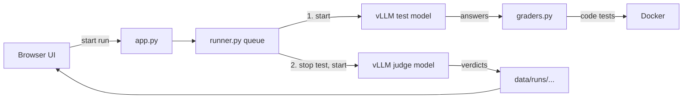

# LLM Evaluation UI

## What is this project?

A web app for testing LLMs that are served with vLLM.
You paste a vLLM command, write a system prompt, pick datasets, and press Start.
The app starts the model, asks it every question, grades the answers, and shows a score per dataset.
You can open any old run and compare runs side by side (for example: same model, two system prompts).

## Why do we need it?

To see how a model (and a system prompt) does on math, tool calling, RAG, terminal commands,
coding, knowledge and your own questions — without typing anything in a terminal.

## How does it work?

Only one model is on the GPU at a time:

1. You fill the **New run** form and press **Start run**.
2. The app starts the **test model** with your vLLM command and waits until it is ready.
3. It sends each question (with your system prompt) to the test model, 8 at a time.
4. Answers with an exact result are graded by code right away:
   - math → compare the final `\boxed{}` number
   - multiple choice → compare the letter
   - coding → run the unit tests **inside Docker** (no network)
   - tool calling → compare function names and arguments
5. The test model is **stopped** to free the GPU.
6. If some answers need a judge (RAG, TruthfulQA, IFEval, NL2Bash, custom datasets,
   or math answers that did not match exactly), the app starts the **judge model**.
   The judge reads question + ground truth + model answer and replies `correct` / `incorrect` + a reason.
7. The judge is stopped. Scores are saved and shown.



## Project folder structure

| Path | Purpose |
|---|---|
| `app.py` | Web server (FastAPI). Serves the UI and the JSON API. |
| `runner.py` | Run queue, start/stop vLLM, ask questions, call the judge, save results. |
| `graders.py` | Grading: math, multiple choice, code in Docker, tool calls, judge prompt. |
| `prepare_datasets.py` | Converts raw datasets on the NAS into `data/datasets/*.jsonl`. Run once. |
| `download_datasets.sh` | Downloads the raw datasets to the NAS (needs root). |
| `config.yml` | Judges, test-model presets, default system prompt, run settings. |
| `static/` | The UI: `index.html`, `style.css`, `app.js`. |
| `data/datasets/` | Converted datasets + your uploaded custom datasets. |
| `data/runs/<run_id>/` | One folder per run: `settings.json`, `results.jsonl`, `summary.json`, `test_model.log`, `judge.log`. |
| `tests/test_graders.py` | Small checks for the graders. |
| `.env` | `hf_token`, `sudo_user` (sudo password, used only to run Docker if plain `docker` is not allowed). |

## Requirements

- Linux with an NVIDIA GPU (tested on one L40S, 46 GB).
- Python 3.12 and `uv` (used to create `.venv`).
- Docker, for the coding datasets (HumanEval, MBPP). Without Docker these two datasets are disabled; everything else works.
- The NAS mounted at `/mnt/truenas` (raw datasets and models live there).

## Installation

Run from `/mnt/newdisk/neel/LLM_EVALUATION`.

1. Create the virtual environment:
   ```bash
   uv venv .venv --python 3.12
   ```
2. Install vLLM (large download, several GB) and pyarrow (reads the parquet dataset files).
   vLLM also brings FastAPI, uvicorn, PyYAML and the OpenAI client, which the app uses.
   ```bash
   VIRTUAL_ENV=.venv uv pip install vllm pyarrow
   ```
3. Download the raw datasets to the NAS. **Needs root** (the NAS folder is not writable by `neel`). Skip if `/mnt/truenas/llm_eval_datasets/raw` already has them.
   ```bash
   sudo bash download_datasets.sh
   ```
4. Convert them into the app's format (writes about 78 MB to `data/datasets/`):
   ```bash
   .venv/bin/python prepare_datasets.py
   ```
   Expected output: 13 lines like `gsm8k 1319`, `bfcl 1000`, `nl2bash 12607`.

## Configuration (`config.yml`)

| Key | Meaning |
|---|---|
| `judges` | List of judge models (name + vLLM command). Shown in the Judge dropdown. Add more in the UI → Settings. |
| `default_judge` | Judge selected by default (`qwen3.5-4b-awq (fast)`). |
| `test_model_presets` | Quick-fill commands for the test model. |
| `run.default_system_prompt` | Pre-filled system prompt. Tells thinking models to think briefly (stops endless thinking loops). |
| `run.quick_size` | Questions per dataset for a Quick run (100). |
| `run.seed` | Random seed. Same seed + same size → same questions, so runs are comparable. |
| `run.temperature` | Default 0.6. Qwen thinking models can loop forever at 0. |
| `run.max_tokens` | Max tokens per answer (thinking + answer). |
| `run.parallel_requests` | Questions sent at the same time (8). |
| `run.code_test_timeout_sec` | Time limit for each coding test (10 s). |
| `run.server_start_timeout_sec` | How long to wait for vLLM to start (900 s). |
| `run.top_p` / `run.top_k` / `run.presence_penalty` | Sampling for the test model (0.95 / 20 / 1.5, Qwen's thinking-mode advice). |
| `run.request_timeout_sec` / `run.judge_timeout_sec` | Time limit for one test-model / judge request (900 s / 600 s). |
| `run.request_retries` | Extra tries after a failed request (0). |
| `run.judge_max_tokens` | Max length of a judge reply (512). |

All `run.*` values and the default judge can be edited in the UI → **Settings → Run settings**.
Saving from the UI rewrites `config.yml` without its comments.

Rules for vLLM commands (the app checks them, because anyone on the network can start a run):
- Must start with `python -m vllm.entrypoints.openai.api_server` or `vllm serve`.
- Must contain `--port <number>`.
- Flags that can load Python code or read any file are refused: `--trust-remote-code`, `--chat-template`,
  `--middleware`, any `*-plugin` or `*-cls` flag, `--logits-processors`, `--allowed-local-media-path`.
- `python` / `vllm` at the start are replaced with this project's `.venv` versions.
- Each model runs alone on the GPU, so `--gpu-memory-utilization 0.9` is fine.

## How to run it

From `/mnt/newdisk/neel/LLM_EVALUATION` (starts a web server on port 7860, reachable from your LAN):

```bash
.venv/bin/python app.py
```

Open `http://<server-ip>:7860` in a browser on any device on the same network.
On this machine the server IP is `100.98.115.240`.

## Example usage

1. **New run** → name `qwen4b-sysprompt`, preset `qwen3.5-4b`, keep the default system prompt,
   tick `gsm8k`, `hotpotqa`, `nl2bash`, `truthfulqa`, choose **Custom 2**, judge `qwen3.5-4b-awq (fast)` → **Start run**.
2. The run page shows `starting_model` → `generating 3/8` → `starting_judge` → `judging` → `done`.
3. Real result from testing (2 questions per dataset):

   | Dataset | With default system prompt | Without system prompt |
   |---|---|---|
   | gsm8k | 50% (1/2) | 0% (0/2) |
   | hotpotqa | 100% (2/2) | 100% (2/2) |
   | nl2bash | 50% (1/2) | 0% (0/2) |
   | truthfulqa | 0% (0/2) | 0% (0/2) |
   | **overall** | **50% (4/8)** | **25% (2/8)** |

   Without the system prompt, Qwen3.5-4B often repeated the same thinking line until `max_tokens`
   (shown as `empty answer: hit max_tokens before finishing`).
4. **Runs** → tick both runs → **Compare selected** → score table + the questions where they disagree.

Links like `http://<server-ip>:7860/#run=<run_id>` and `#compare=<id1>,<id2>` open a page directly.

### Custom datasets

**Datasets** page → upload a `.jsonl` (one JSON object per line) or `.csv` (header row). Needs `question` and `ground_truth`; `context` is optional. Graded by the judge.

```json
{"question": "Capital of France?", "ground_truth": "Paris"}
```

## How the code works

- `app.py` → each button in the UI calls one route (`/api/runs`, `/api/datasets/upload`, `/api/compare`, ...).
- `runner.submit_run()` checks the form and puts the run in a queue.
  One background thread runs `execute_run()` for one run at a time:
  `start_server` → `generate_answers` → `stop_server` → `start_server(judge)` → `judge_answers` → `summarize`.
- `graders.grade_without_judge()` picks the grader from each question's `grader` field
  (`math`, `choice`, `code`, `tool_call`, `judge`).
- Every answer is appended to `results.jsonl` as soon as it arrives, so a crash does not lose finished answers.

## Common errors and solutions

| What you see | Likely cause | Fix |
|---|---|---|
| Run `failed`, log ends with `CUDA out of memory` | Another process is using the GPU | `nvidia-smi` to find it; stop it, or lower `--gpu-memory-utilization` |
| `port 8001 already in use` | A vLLM server (or something else) is already on that port | Stop it, or change `--port` in the command |
| `max_num_seqs (256) exceeds available Mamba cache blocks` | Too little GPU memory for vLLM's default 256 parallel sequences | Raise `--gpu-memory-utilization` or add `--max-num-seqs 16` |
| `No such file or directory: 'ninja'` in the model log | vLLM started without `.venv/bin` on PATH | Already handled by `runner.start_server`; only appears if you start vLLM yourself outside the venv |
| Many `empty answer: hit max_tokens before finishing` | Thinking model loops or thinks too long | Keep the default system prompt, raise Max tokens, or use temperature 0.6 instead of 0 |
| Coding datasets show "needs Docker" | Plain `docker` gives *permission denied* and `sudo_user` in `.env` is missing or wrong | Add your user to the `docker` group, or fix `sudo_user` in `.env` |
| `unknown dataset` / empty dataset list | `prepare_datasets.py` not run, or NAS not mounted | `ls /mnt/truenas/llm_eval_datasets/raw`, then run `prepare_datasets.py` |
| Run shows `interrupted` | The app was stopped or restarted during that run (the app stops its vLLM on Ctrl-C) | Start the run again; finished answers are in its `results.jsonl` |
| `flag --... is not allowed` | The command uses a vLLM flag that can run code | Remove the flag; start such models by hand outside the app |

## How to test it

Grader checks (no GPU needed, Docker not needed):

```bash
.venv/bin/python tests/test_graders.py
```

Expected last line: `ALL PASSED`.

Full check: start the app, run the example above with **Custom 2**, and check that the run reaches `done`.

## Security notes

- The UI has no login. Anyone on the same network can start runs. Commands are limited to vLLM servers and run without a shell.
- `--trust-remote-code` and other code-loading vLLM flags are refused (see Configuration). Models that need them must be started by hand, outside the app.
- Coding tests run in Docker with no network, 512 MB memory, 1 CPU, max 64 processes.
- `.env` holds the sudo password in plain text (used only for `sudo docker`). Adding your user to the `docker` group and removing `sudo_user` is safer.
